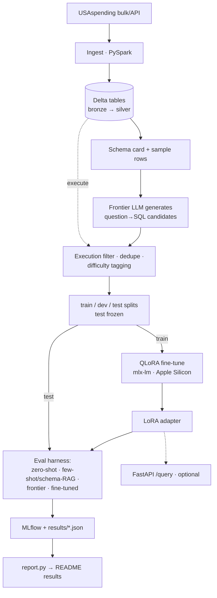

# Text2SQL-usaspending-finetune

QLoRA fine-tune of a ~3B open model that turns natural-language questions about federal spending into **Spark SQL** over **USAspending.gov** award data in **Delta** tables. It's evaluated on **execution accuracy** against zero-shot, few-shot/schema-RAG, and frontier-model baselines.

> Status: pipeline built end to end (ingest → synth → train → eval), with baselines run on both local Spark and Databricks Unity Catalog, plus a Databricks Genie baseline and a secondary LLM-judge metric. The test set is small (see Limitations), so treat the numbers as preliminary.

## Results

Generated by `scripts/report.py` from `results/*.json`. Never edit it by hand.

<!-- RESULTS:START -->
Frozen test set, n = 27 questions. Each run records its `execution_backend`: `databricks_uc` (Unity Catalog on a Databricks Free Edition workspace) or `local_spark` (local Spark over the same silver tables).

### Databricks Unity Catalog runs

| Run | Execution acc. (primary) | Judge-equivalent (secondary) | Exact match | Valid SQL | p50 latency | p95 latency |
|---|---|---|---|---|---|---|
| Base model, zero-shot | 2/27 (7.4%) | 4/27 (14.8%) | 0.0% | 18.5% | 2.9s | 5.1s |
| Base model, few-shot (schema-RAG) | 11/27 (40.7%) | 13/27 (48.1%) | 14.8% | 77.8% | 20.3s | 23.9s |
| Frontier model, few-shot | 19/27 (70.4%) | 25/27 (92.6%) | 25.9% | 100.0% | 1.5s | 3.3s |
| Fine-tuned (QLoRA), zero-shot | 13/27 (48.1%) | 13/27 (48.1%) | 29.6% | 77.8% | 2.3s | 4.6s |
| Databricks Genie space | 15/27 (55.6%) | 21/27 (77.8%) | 0.0% | 100.0% | 14.0s | 19.0s |

Execution accuracy by difficulty tag:

| Tag | Base model, zero-shot | Base model, few-shot (schema-RAG) | Frontier model, few-shot | Fine-tuned (QLoRA), zero-shot | Databricks Genie space |
|---|---|---|---|---|---|
| aggregation | 25.0% (n=4) | 25.0% (n=4) | 75.0% (n=4) | 75.0% (n=4) | 75.0% (n=4) |
| filter_date_fy | 0.0% (n=4) | 75.0% (n=4) | 100.0% (n=4) | 75.0% (n=4) | 100.0% (n=4) |
| join | 0.0% (n=3) | 66.7% (n=3) | 33.3% (n=3) | 0.0% (n=3) | 33.3% (n=3) |
| nested | 25.0% (n=4) | 50.0% (n=4) | 75.0% (n=4) | 50.0% (n=4) | 50.0% (n=4) |
| single_table | 0.0% (n=4) | 25.0% (n=4) | 50.0% (n=4) | 25.0% (n=4) | 25.0% (n=4) |
| top_n | 0.0% (n=4) | 50.0% (n=4) | 100.0% (n=4) | 75.0% (n=4) | 75.0% (n=4) |
| window | 0.0% (n=4) | 0.0% (n=4) | 50.0% (n=4) | 25.0% (n=4) | 25.0% (n=4) |

### Fine-tune vs Genie vs frontier

| Run | Correct by execution accuracy | Judge-equivalent |
|---|---|---|
| Fine-tuned (QLoRA), zero-shot | 13/27 (48.1%) | 13/27 (48.1%) |
| Databricks Genie space | 15/27 (55.6%) | 21/27 (77.8%) |
| Frontier model, few-shot | 19/27 (70.4%) | 25/27 (92.6%) |

With n = 27, one question is 3.7 points. The gap between the highest and lowest of these runs is 6 questions by execution accuracy; a 2-question difference between two runs is not statistically significant.

Genie's space was configured over: workspace.usaspending.agencies, workspace.usaspending.award_transactions, workspace.usaspending.recipients; the space had no custom instructions.

Judge: `databricks:/databricks-gpt-oss-120b` (run 2026-11-01), a secondary metric that never replaces execution accuracy. A human reviewed the 16 records where the judge and execution accuracy disagreed and agreed with the judge on all of them (execution accuracy was a false negative: extra or missing columns, aliases, `DISTINCT`, redundant filters). Records where both agreed were not hand-checked.

### Earlier local Spark runs

Kept for parity checks. `base_zero_shot` here was scored before the SQL post-processing fix (markdown-fence stripping), so its 0% is a formatting artifact.

| Run | Execution acc. (primary) | Judge-equivalent (secondary) | Exact match | Valid SQL | p50 latency | p95 latency |
|---|---|---|---|---|---|---|
| Base model, zero-shot | 0/27 (0.0%) | not yet run | 0.0% | 0.0% | 2.7s | 4.7s |
| Base model, few-shot (schema-RAG) | 11/27 (40.7%) | not yet run | 14.8% | 77.8% | 19.0s | 22.0s |
| Frontier model, few-shot | 18/27 (66.7%) | not yet run | 22.2% | 96.3% | 2.2s | 3.5s |
| Fine-tuned (QLoRA), zero-shot | 13/27 (48.1%) | not yet run | 29.6% | 77.8% | 2.2s | 4.6s |

Generated from `results/*.json` (git commits: 1b6e4f9, 706d3af, f304243, fbfa1ba). Cost per 1K queries: not yet measured.
<!-- RESULTS:END -->

## Pipeline



## Approach

1. Ingest a bounded slice of USAspending award data into Delta (bronze → silver) with PySpark.
2. Build a schema card, the only schema context given to models.
3. Generate question→SQL pairs with a frontier model, and keep only pairs whose SQL executes.
4. Stratified train/dev/test splits by difficulty, then freeze the test set.
5. QLoRA fine-tune with `mlx-lm` on Apple Silicon.
6. Evaluate all baselines on the same frozen test set and track runs in MLflow.

See [AGENTS.md](AGENTS.md) for the full spec, rules, and commands.

## Quickstart

```bash
uv sync --extra dev
uv run pytest
```

## Limitations

- Gold SQL is generated by a frontier model and filtered by execution. Only a hand-verified subset is reviewed by a person.
- The local `base_zero_shot` run predates the SQL post-processing fix in `c5d1bdb` (markdown-fence/label stripping), so its 0% is a formatting artifact. The Databricks Unity Catalog re-run above uses the current post-processing.
- Small dataset: 264 kept pairs (210 train / 27 dev / 27 test). With 27 test questions each question moves a score by about 3.7 points, and per-tag cells have n≈3–4, so differences between runs are not statistically meaningful yet.
- The hand-verified `test_verified` subset has not been built yet.
- Cost per 1K queries is not yet measured.
- Single schema (USAspending), one awarding agency (Department of Veterans Affairs), and a limited slice of fiscal years (FY2022–FY2024).
- Synthetic questions may not match how real users phrase things.
- Execution accuracy compares full result sets, so it scores answers with extra or missing columns, aliases, or `DISTINCT` as wrong. The LLM judge is a secondary metric; a human checked only the 16 records where judge and execution accuracy disagreed, not the ones where they agreed.
- The Genie space was configured over three of the four silver tables (no `locations`) and without custom instructions, so its score is not a tuned Genie result. Latencies depend on a Databricks Free Edition workspace and are not production numbers.
- The frontier baseline is re-sampled on each run (local 18/27 vs Unity Catalog 19/27), so its score varies by about a question.

## Next phase

- `backend: mlx | hf` training/inference switch (transformers + PEFT + TRL, bitsandbytes 4-bit) on a GPU cluster.
- Restore the Qwen2.5-7B base model.
- Model Serving endpoint with AI Gateway inference tables; `ai_query()` batch evaluation.
- Lakeflow Jobs via a Databricks Asset Bundle: ingest → synth → train → eval.
- Larger, hand-verified (`test_verified`) test set, possibly with the full agency scope.

## Data

Federal spending data from [USAspending.gov](https://www.usaspending.gov/), a public U.S. government source.
