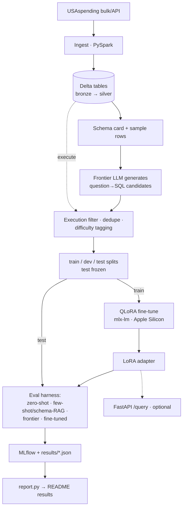

# Text2SQL-usaspending-finetune

QLoRA fine-tune of a ~3B open model that turns natural-language questions about federal spending into **Spark SQL** over **USAspending.gov** award data in **Delta** tables. It's evaluated on **execution accuracy** against zero-shot, few-shot/schema-RAG, and frontier-model baselines.

> Status: pipeline built end to end (ingest → synth → train → eval). First baseline evals are in; the test set is small (see Limitations), so treat the numbers as preliminary.

## Results

Generated by `scripts/report.py` from `results/*.json`. Never edit it by hand.

<!-- RESULTS:START -->
Frozen test set, n = 27 questions.

| Run | Execution acc. | Exact match | Valid SQL | p50 latency | p95 latency |
|---|---|---|---|---|---|
| Base model, zero-shot | 0.0% | 0.0% | 0.0% | 2.7s | 4.7s |
| Base model, few-shot (schema-RAG) | 40.7% | 14.8% | 77.8% | 19.0s | 22.0s |
| Frontier model, few-shot | 66.7% | 22.2% | 96.3% | 2.2s | 3.5s |
| Fine-tuned (QLoRA), zero-shot | 48.1% | 29.6% | 77.8% | 2.2s | 4.6s |

Execution accuracy by difficulty tag:

| Tag | Base model, zero-shot | Base model, few-shot (schema-RAG) | Frontier model, few-shot | Fine-tuned (QLoRA), zero-shot |
|---|---|---|---|---|
| aggregation | 0.0% (n=4) | 25.0% (n=4) | 75.0% (n=4) | 75.0% (n=4) |
| filter_date_fy | 0.0% (n=4) | 75.0% (n=4) | 100.0% (n=4) | 75.0% (n=4) |
| join | 0.0% (n=3) | 66.7% (n=3) | 0.0% (n=3) | 0.0% (n=3) |
| nested | 0.0% (n=4) | 50.0% (n=4) | 75.0% (n=4) | 50.0% (n=4) |
| single_table | 0.0% (n=4) | 25.0% (n=4) | 50.0% (n=4) | 25.0% (n=4) |
| top_n | 0.0% (n=4) | 50.0% (n=4) | 100.0% (n=4) | 75.0% (n=4) |
| window | 0.0% (n=4) | 0.0% (n=4) | 50.0% (n=4) | 25.0% (n=4) |

Generated from `results/*.json` (git commits: 1b6e4f9, f304243). Cost per 1K queries: not yet measured.
<!-- RESULTS:END -->

## Pipeline



## Approach

1. Ingest a bounded slice of USAspending award data into Delta (bronze → silver) with PySpark.
2. Build a schema card, the only schema context given to models.
3. Generate question→SQL pairs with a frontier model, and keep only pairs whose SQL executes.
4. Stratified train/dev/test splits by difficulty, then freeze the test set.
5. QLoRA fine-tune with `mlx-lm` on Apple Silicon.
6. Evaluate all baselines on the same frozen test set and track runs in MLflow.

See [AGENTS.md](AGENTS.md) for the full spec, rules, and commands.

## Quickstart

```bash
uv sync --extra dev
uv run pytest
```

## Limitations

- Gold SQL is generated by a frontier model and filtered by execution. Only a hand-verified subset is reviewed by a person.
- The `base_zero_shot` and `finetuned` runs were produced before the SQL post-processing fix in `c5d1bdb` (markdown-fence/label stripping). Base zero-shot's 0% is largely that formatting artifact (it wraps SQL in code fences), so those two rows are stale and should be re-run before drawing conclusions.
- Small dataset: 264 kept pairs (210 train / 27 dev / 27 test). With 27 test questions each question moves a score by about 3.7 points, and per-tag cells have n≈3–4, so differences between runs are not statistically meaningful yet.
- The hand-verified `test_verified` subset has not been built yet.
- Cost per 1K queries is not yet measured.
- Single schema (USAspending) and a limited slice of fiscal years.
- Synthetic questions may not match how real users phrase things.

## Data

Federal spending data from [USAspending.gov](https://www.usaspending.gov/), a public U.S. government source.
